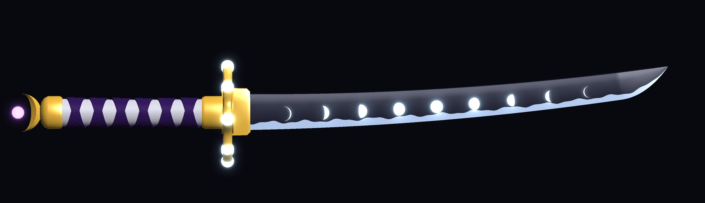
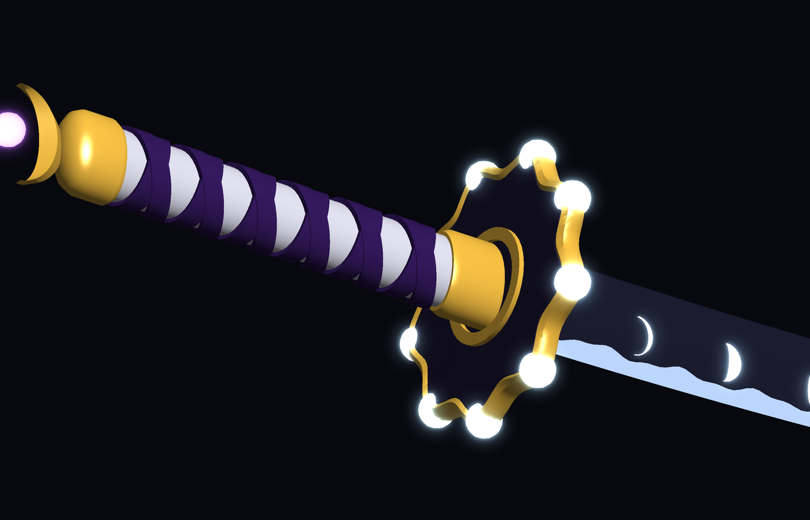

# King of the Nine Moons

Катана для Roblox: процедурно сгенерированная модель в `.obj` и скрипт, который
превращает её в готовый `Tool` с эффектами.




## Что внутри

| Путь | Назначение |
| --- | --- |
| `models/KingOfTheNineMoons.obj` + `.mtl` | Вся катана, 12 именованных деталей, ~20 тыс. треугольников |
| `models/parts/*.obj` | Те же детали отдельными файлами |
| `roblox/SetupKatana.lua` | Настройка в Studio: материалы, свечение, частицы, след удара, боевой скрипт |
| `tools/generate_katana.py` | Генератор модели |
| `tools/render_preview.py` | Рендер картинок в `preview/` |

Детали: `Blade`, `Hamon` (линия закалки), `Moons` (девять фаз луны на клинке),
`Habaki`, `Tsuba` (девятилепестковая гарда), `GuardRim`, `MoonOrbs` (девять лун на гарде),
`Fuchi`, `Tsuka`, `Ito` (оплётка), `Kashira` (навершие с полумесяцем), `CrownGem`.

Оси: клинок вдоль +Y, лезвие в сторону +Z, 1 единица = 1 stud (длина около 5.8 studs).

## Импорт в Roblox Studio

1. **File → Import 3D** → `models/KingOfTheNineMoons.obj`. Отключите *Import as single mesh*,
   единицы — *Stud*.
2. Выделите импортированную модель в Explorer.
3. Откройте **View → Command Bar**, вставьте содержимое `roblox/SetupKatana.lua`, нажмите Enter.

В `StarterPack` появится инструмент «King of the Nine Moons»: неоновые луны пульсируют,
с клинка сыплется лунная пыль, при ударе включается светящийся след, каждый девятый
удар наносит тройной урон со вспышкой. Урон и перезарядка настраиваются константами
в начале `KatanaServer`.

## Пересборка модели

```sh
cd tools
uv run --with numpy --with pillow python generate_katana.py
uv run --with numpy --with pillow python render_preview.py
```
