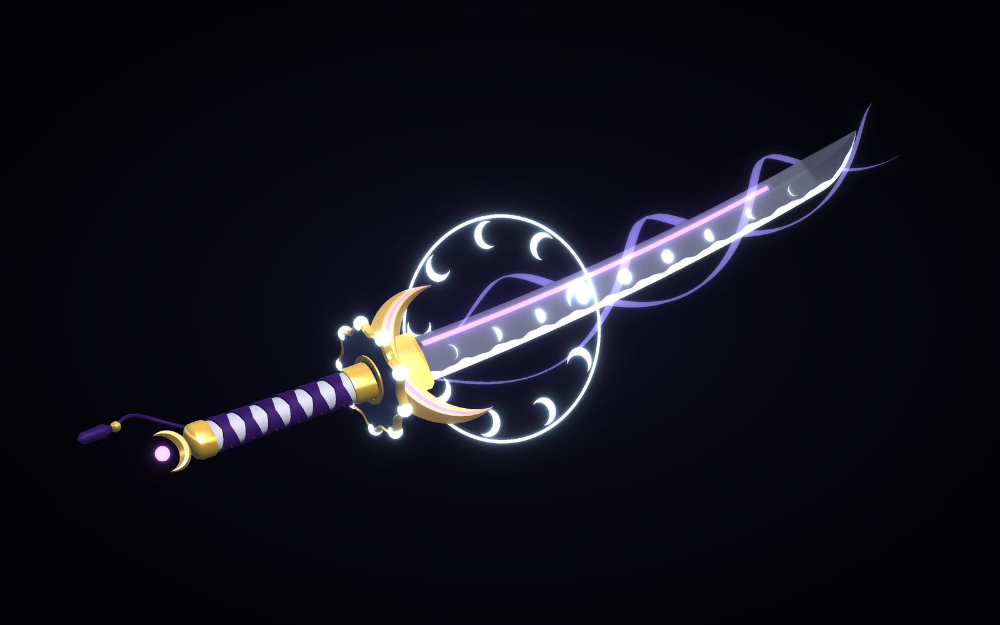

# King of the Nine Moons

Катана для Roblox: процедурно сгенерированная модель в `.obj` и скрипт, который
превращает её в готовый `Tool` с эффектами.




## Что внутри

| Путь | Назначение |
| --- | --- |
| `models/KingOfTheNineMoons.obj` + `.mtl` | Вся катана, 17 именованных деталей, ~33 тыс. треугольников (каждая деталь меньше 6 тыс.) |
| `models/parts/*.obj` | Те же детали отдельными файлами |
| `roblox/SetupKatana.lua` | Настройка в Studio: материалы, свечение, частицы, следы удара, вращение ореола, боевой скрипт |
| `tools/generate_katana.py` | Генератор модели |
| `tools/render_preview.py` | Рендер картинок в `preview/` |

Детали клинка: `Blade`, `Hamon` (линия закалки), `EdgeGlow` (светящаяся кромка),
`Vein` (светящийся дол), `Moons` (девять фаз луны).
Гарда: `Habaki`, `MoonGuard` (большой полумесяц), `Tsuba` (девять лепестков), `GuardRim`, `MoonOrbs`.
Рукоять: `Fuchi`, `Tsuka`, `Ito` (оплётка и кисть), `Kashira` (навершие-полумесяц), `CrownGem`.
Эффекты: `MoonAura` (энергетические ленты вокруг клинка), `MoonHalo` (кольцо из девяти лун).

Оси: клинок вдоль +Y, лезвие в сторону +Z, 1 единица = 1 stud (длина около 7 studs).
Скрипт настройки ожидает все 17 деталей, поэтому лишние эффекты удаляйте уже из готового инструмента.

## Импорт в Roblox Studio

1. **File → Import 3D** → `models/KingOfTheNineMoons.obj`. Отключите *Import as single mesh*,
   единицы — *Stud*.
2. Выделите импортированную модель в Explorer.
3. Откройте **View → Command Bar**, вставьте содержимое `roblox/SetupKatana.lua`, нажмите Enter.

В `StarterPack` появится инструмент «King of the Nine Moons»:

- луны, дол и камень пульсируют, аура мерцает;
- кольцо из девяти лун вращается вокруг клинка и ускоряется при взмахе;
- с клинка сыплются лунная пыль и фиолетовые искры;
- при взмахе — двойной светящийся след и вспышка света;
- каждый девятый удар наносит тройной урон со взрывом частиц и ударной волной.

Урон, перезарядка и скорость ореола настраиваются константами в начале `KatanaServer`.

## Пересборка модели

```sh
cd tools
uv run --with numpy --with pillow python generate_katana.py
uv run --with numpy --with pillow python render_preview.py
```
